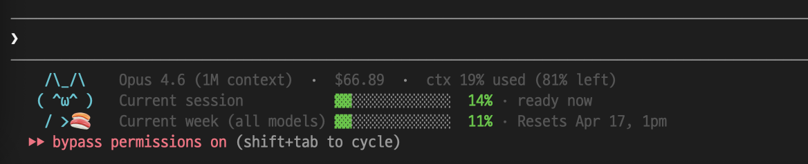

# 🐾 claude-cat

> **오프라인 전용 Claude Code 상태 표시줄.** 네트워크 한 번 안 타고 남은 사용량을 고양이가 알려줍니다.

[English README →](./README.md)

[](https://www.npmjs.com/package/claude-cat)
[](https://www.npmjs.com/package/claude-cat)
[](LICENSE)
[](https://nodejs.org)
[](https://packagephobia.com/result?p=claude-cat)
[](#why-claude-cat)
[](#why-claude-cat)
[](https://github.com/thingineeer/claude-cat/graphs/commit-activity)

> **🆕 Claude Code 2.1.327 대응** (2026-11-19) — 실제 statusLine 페이로드로
> 검증했습니다. 주간 한도만 있는 **Ultra** 플랜(구 Max), 한 줄에 `week` +
> `fable`, 새 `spend_limit` 창, `Opus 5.5` / `Fable 5.2` 모델 chip 을
> 지원합니다. [stdin 필드](#stdin-필드-claude-code-21327) 참조.

<p align="center">
  
  <br />
  <em>3줄 kawaii 카드 — <code>--full --kawaii</code></em>
</p>

<a id="why-claude-cat"></a>
## 🛡️ 왜 claude-cat

claude-cat 은 Claude Code 가 statusLine 스크립트에 **이미 stdin 으로 넘겨주는
JSON** 만 읽어 렌더링합니다. 그 이상은 아무것도 안 합니다 — 이게 전체 설계
이자 전체 안전 서사입니다:

- **🚫 네트워크 호출 0회.** `api.anthropic.com` 안 부름.
  `claude.ai` 안 부름. `/api/oauth/usage` 안 부름. 방화벽 뒤에서도
  그대로 작동. `tcpdump` 찍어도 아무것도 안 나옴.
- **🚫 크레덴셜 읽기 0회.** `~/.claude/.credentials.json`, macOS
  Keychain, OAuth 토큰 **절대** 안 건드림. npm 계정이 털려도
  최악의 시나리오가 "상태 표시줄이 이상하게 나옴" — Anthropic
  계정 탈취는 불가.
- **🚫 외부로 쓰기 0회.** `~/.claude/claude-cat/` (로컬 sync 캐시 +
  디버그 덤프)만 씀. 컴퓨터 밖으로 나가는 바이트 없음.
- **✅ stdin-only 정책.** [`SECURITY.md`](./SECURITY.md) 에 명시되어
  있고 프로젝트의 threat model 로 못박힘. 부수 효과가 아닌 설계
  의도.

### 다른 Claude Code statusLine / 사용량 도구들과 비교

| 항목 | **claude-cat** | ccstatusline | claude-dashboard | ccusage |
| --- | :---: | :---: | :---: | :---: |
| statusLine 실시간 렌더링 | ✅ | ✅ | ✅ | ❌ (CLI) |
| **네트워크 호출 없음** | **✅** | ❌ (Anthropic API) | ❌ (Anthropic API) | 🟡 (pricing fetch, `--offline` 가능) |
| **OAuth / 크레덴셜 읽기 없음** | **✅** | ❌ | ❌ | ✅ |
| kawaii 고양이 mood 😺 | ✅ | ❌ | ❌ | ❌ |
| 여러 터미널 간 sync | ✅ | ❌ | ❌ | n/a |
| 과거 / 비용 리포트 | ❌ | 🟡 | ✅ | ✅ |

**언제 claude-cat 을 고르나**: 친근한 항상-켜진 상태줄 원하고,
툴체인이 뒤에서 Anthropic 과 몰래 통신하지 않길 바라는 경우.
**[`ccusage`](https://github.com/ryoppippi/ccusage) 와 병행 추천**
— 두 툴은 겹치지 않음 (claude-cat = 실시간 렌더, ccusage = 비용
분석).

> "그냥 고양이" 는 귀여운 태그라인이 아니라 threat model 입니다.

## 설치

### 빠른 설정 (추천)

인터랙티브 wizard 를 실행하세요 — 레이아웃, 고양이 테마, 리프레시 주기,
플랜을 30초 안에 설정합니다:

```bash
npx -y claude-cat@latest configure
```

`~/.claude/settings.json` 을 자동으로 수정해주며 (diff 미리보기 후 확인),
다른 키는 건드리지 않습니다. Claude Code 재시작하면 다음 턴부터 보입니다.

### 수동 설정 (프롬프트 붙여넣기)

모드 골라서 아래 프롬프트를 Claude Code 에 붙여넣으면 됩니다.

### A) ⭐ 기본 — compact, 한 줄 *(추천)*

깔리는 것: 한 줄에 모델 · effort + 사용량 바 + `$` 비용 + `ctx %`. 고양이 없음. 좁은 터미널에선 자동 줄바꿈.

```text
opus 5.5 · xhigh | week ▓▓▓▓▓▓▓░░░ 66% (Sun 10pm) | $12.34 | ctx 18%
```

Ultra(구 Max)는 주간 한도만 있어서 지금은 이게 전부입니다. Claude Code 가
Fable 주간 버킷도 보내주면 플래그 없이 같은 줄에 붙습니다:

```text
fable 5.2 · high | week ▓▓▓▓▓▓▓░░░ 66% (Sun 10pm) | fable ▓▓▓░░░░░░░ 34% (Sun 10pm) | $12.34 | ctx 18%
```

5시간 세션 창이 있는 플랜이면 `week` 앞에 `5h ▓▓▓▓░░░░░░ 47% (1h 19m)` 바가 붙습니다.

```text
Install claude-cat (https://github.com/thingineeer/claude-cat) into my
~/.claude/settings.json as the statusLine.

- type: "command"
- command: "npx -y claude-cat@latest"
- padding: 0
- refreshInterval: 300

Don't touch any other key. Show me the diff first.
```

### B) 3줄 kawaii 고양이

깔리는 것: 3줄 카드 — 왼쪽엔 ASCII 고양이, 오른쪽엔 데이터 행. 사용량에 따라 얼굴과 소품이 바뀝니다.
header 줄에 모델 · effort · 비용 · ctx 가 들어가며, effort 는 header 의 빈 폭에
들어가므로 카드는 그대로 3줄입니다.

```text
 /\_/\    Fable 5.2 · high  ·  $12.34  ·  ctx 18% used (82% left)
( -ㅅ-)   Current week (all models) ▓▓▓▓▓▓▓▓▓░░░░░  66% · Resets Nov 22, 10pm
 / づ☕    Current week (Fable)      ▓▓▓▓▓░░░░░░░░░  34% · Resets Nov 22, 10pm
```

```text
Install claude-cat (https://github.com/thingineeer/claude-cat) into my
~/.claude/settings.json as the statusLine.

- type: "command"
- command: "npx -y claude-cat@latest --full --kawaii"
- padding: 0
- refreshInterval: 300

Don't touch any other key. Show me the diff first.
```

<details>
<summary>전체 모드 한눈에 보기</summary>

설치 방식은 같고 `command` 값만 바꾸면 됩니다.

<table>
<thead>
<tr><th>플래그</th><th>명령어</th><th>미리보기</th></tr>
</thead>
<tbody>
<tr>
<td><strong>⭐ (기본값)</strong></td>
<td><code>npx -y claude-cat@latest</code></td>
<td><pre>opus 5.5 · xhigh | week ▓▓░░░░░░░░ 18% (Fri 1pm) | $0.123</pre></td>
</tr>
<tr>
<td><code>--full --kawaii</code></td>
<td><code>npx -y claude-cat@latest --full --kawaii</code></td>
<td><pre> /\_/\   Opus 5.5 · xhigh · $0.123
( ^ω^ )  week     ▓▓▓░░░░░░░░░░░ 18% · Resets Nov 20, 1pm
 / >🍣</pre></td>
</tr>
<tr>
<td><code>--full</code></td>
<td><code>npx -y claude-cat@latest --full</code></td>
<td><pre>/ᐠ ^ᴥ^ ᐟ\  Opus 5.5 · xhigh · $0.123
week     ▓▓▓░░░░░░░░░░░ 18% · Resets Nov 20, 1pm</pre></td>
</tr>
<tr>
<td><code>--wide</code></td>
<td><code>npx -y claude-cat@latest --wide</code></td>
<td><pre>week ▓░░░░░░░ 18% (Fri 1pm) | $0.123</pre></td>
</tr>
<tr>
<td><code>--full --no-cat</code></td>
<td><code>npx -y claude-cat@latest --full --no-cat</code></td>
<td><pre>Opus 5.5 · xhigh · $0.123
week     ▓▓▓░░░░░░░░░░░ 18% · Resets Nov 20, 1pm</pre></td>
</tr>
</tbody>
</table>

`--no-model` (compact 의 모델 chip 숨김 — effort 도 같이 빠짐), `--no-effort`
(모델은 두고 `· high` effort 만 숨김 — compact 와 `--full` 공통).
전체 플래그/환경변수: 영문 README 참조.
`--hide=opus,sonnet` — `week · fable` 만 남김 (5h 있는 플랜은 `5h` 포함).
`CLAUDE_CAT_PLAN=pro|ultra|auto` — Pro 사용자는 `pro` 설정하면 주간 bar
자동 숨김 (wizard가 자동 설정). 예전 값 `max` 도 그대로 동작하며 `ultra` 와 같습니다.

</details>

## 출력 읽는 법

```text
fable 5.2 · high | week ▓▓▓▓▓▓▓░░░ 66% (Sun 10pm) | fable ▓▓▓░░░░░░░ 34% (Sun 10pm) | $12.34 | ctx 18%
```

| 칩 | 의미 |
| --- | --- |
| `opus 5.5` / `fable 5.2` / `sonnet 5.5` | 이 세션이 대화 중인 모델 — compact 전용 (`--full` 은 header 에 전체 이름 표시). `--no-model` 로 숨김 |
| `· high` / `· max` | 세션의 effort level (`effort.level` — `low` / `medium` / `high` / `xhigh` / `max`). compact 와 `--full` 모두 모델 chip 뒤에 붙음. `--no-effort` 로 숨김 |
| `week` / `fable` / `5h` / `spend` | rate-limit 창 — 주간(전체 모델) / Fable 주간 / 5시간 세션(있는 플랜만) / Claude apps gateway 지출 한도. 그 밖의 `rate_limits.seven_day_<model>` 은 `<model>` 로 자동 표시 |
| `▓▓▓▓░░░░░░` | 10칸 진행 바 — 초록 → 노랑 → 빨강 |
| `66%` | 정확한 퍼센트 |
| `(Sun 10pm)` / `(1h 19m)` | 리셋 시점 — 주간은 절대, 5시간 세션은 상대 |
| `$12.34` | **이 세션의 누적 비용 (USD)** — 아래 설명 |
| `ctx 18%` | 현재 대화의 컨텍스트 사용률 |

### `$12.34` 이 무엇이고 — 무엇이 아닌지

**이 Claude Code 세션의 누적 비용** 입니다 (`cost.total_cost_usd`).

- ❌ 플랜 초과 "Extra usage" 요금 **아님** (다른 개념, statusLine 에 안 옴)
- ❌ 월 구독료 **아님**
- ❌ Pro/Ultra 면 지금 빠져나가는 돈 **아님** (정액제 — 참고용 숫자)
- ✅ **API key** 모드면 실제 비용. **Bedrock / Vertex** 에선 `$0.00` 고정

이 값은 Claude Code 가 정가(또는
[`modelPricing`](https://code.claude.com/docs/en/settings-reference#modelpricing) 표)로
직접 계산한 것이고, claude-cat 은 다시 계산하지 않습니다 — stdin 에 모델별
누적 토큰이 없어서 재계산하면 오히려 부정확해집니다. 참고용 현행 정가 (MTok 당,
[모델 개요](https://platform.claude.com/docs/ko/models/overview)):

| 모델 | 입력 / MTok | 출력 / MTok |
| ---- | ----------: | ----------: |
| Claude Fable 5.2 *(최신)* | $8 | $40 |
| Claude Fable 5.1 *(레거시)* | $10 | $50 |
| Claude Opus 5.5 | $4 | $20 |
| Claude Sonnet 5.5 | $2 | $10 |
| Claude Haiku 5.5 | $0.10부터 | $0.50부터 |

## 고양이 mood

고양이는 `--full` 모드에서만 나옵니다. 6가지 — 5개는 사용률, 1개(resting)는 상태 기반.

| 상태 | `--full` (1줄 face) | `--full --kawaii` 소품 |
| ---- | ------------------- | ---------------------- |
| 대기 중 *(resting)* | `/ᐠ -ᴥ- ᐟ\` | 🚬 담배 |
| 0–30 % *(chill)* | `/ᐠ ^ᴥ^ ᐟ\` | 🍣 초밥 |
| 30–60 % *(curious)* | `/ᐠ •ᴥ• ᐟ\` | ⌨️ 키보드 |
| 60–85 % *(alert)* | `/ᐠ ◉ᴥ◉ ᐟ\` | ☕ 커피 |
| 85–95 % *(nervous)* | `/ᐠ ⊙ᴥ⊙ ᐟ\` | 💤 휴식 |
| 95 %+ *(critical)* | `/ᐠ ✖ᴥ✖ ᐟ\` | 🛌 기절 |

mood 정책: `주간 ≥ 60 %` 또는 `세션 ≥ 75 %` → alert, 어느 창이든 ≥ 85 → nervous,
≥ 95 → critical. 주간 한도만 있는 플랜(Ultra)은 주간 값만으로 결정됩니다.

## 플랜별 호환

| 플랜 | 표시 | 비고 |
| ---- | ---- | ---- |
| Claude **Ultra** *(구 Max)* | `week` 바 (+ 들어오면 `fable`), 주간 리셋, 고양이, 세션 비용 | 주간 한도만 — Claude Code 2.1.327 은 `rate_limits.seven_day` 만 보냄 |
| Claude Pro | `5h` + `week` 바 (`CLAUDE_CAT_PLAN=pro` 면 주간 숨김) | `rate_limits` 는 첫 응답 이후 등장 |
| Claude apps gateway | `spend` 바 (지출 한도 %) + 비용 | `rate_limits.spend_limit`, Claude Code ≥ 2.1.251 |
| Anthropic API 키 | 세션 비용 + 고양이 | rate_limits 없음 |
| Bedrock / Vertex | 비용 `$0.00` 고정 | 상위 제약 |

<a id="stdin-필드-claude-code-21327"></a>
## stdin 필드 (Claude Code 2.1.327)

2026-11-19 실제 페이로드 덤프(`CLAUDE_CAT_DEBUG=1` →
`~/.claude/claude-cat/last-stdin.json`)와
[statusLine 문서](https://code.claude.com/docs/en/statusline)로 확인했습니다.

| 필드 | 용도 |
| ---- | ---- |
| `rate_limits.seven_day` | `week` 바 — 모든 구독 플랜 |
| `rate_limits.five_hour` | `5h` 바 — **Ultra 에는 없음**, `resets_at` 이 지나도 빠짐 |
| `rate_limits.seven_day_<model>` | 모델별 주간 바 (`fable`, `opus`, `sonnet` …) — 들어오면 자동 표시 |
| `rate_limits.spend_limit` | Claude apps gateway 의 `spend` 바 |
| `model.display_name` | 모델 chip (`Opus 5.5` → `opus 5.5`) |
| `effort.level` | `· xhigh` effort chip |
| `cost.total_cost_usd` | `$` chip |
| `context_window.used_percentage` | `ctx` chip |

새로 생겼지만 아직 표시하지 않는 필드: `prompt_cache`, `workspace.repo`, `pr`,
`session_name`, `prompt_id`.

## stdin 에 (아직) 없는 것

- **Fable 주간 한도** — Ultra 의 `/usage` 에는 Fable 행이 있지만(주간 한도의 최대
  절반까지 사용 가능), Claude Code 2.1.327 의 statusLine stdin 에는 `seven_day` 만
  옵니다. Claude Code 가 `rate_limits.seven_day_fable`(또는 예전
  `seven_day_overage_included`)을 보내는 순간 `fable` 바로 자동 표시되고, 그전까진
  `week` 만 나옵니다.
- **Extra usage** (`$14 / $20 spent` 등) — `/api/oauth/usage`(비공개 엔드포인트)에만 있음.

claude-cat 은 의도적으로 stdin 만 읽습니다 ([왜 claude-cat](#why-claude-cat) 참조).

## 보안

claude-cat 은 의도적으로 작고 네트워크를 타지 않습니다 — Claude Code 가
매 메시지마다 실행하는 경로니까 가볍고 안전해야 하기 때문입니다.

**하는 것** — Claude Code 가 statusLine 스크립트에 이미 흘려보내는 stdin JSON
을 읽어서 컬러 한 줄을 출력.

**안 하는 것** — 네트워크 요청 없음, 크레덴셜 읽기 없음, Keychain 접근 없음,
`~/.claude/claude-cat/` 밖으로 쓰기 없음. 불변 규칙은 [SECURITY.md](./SECURITY.md) 에.

### npm 공급망(supply chain) 관련

`npx -y claude-cat@latest` 는 최신 버전을 매번 다운받아 실행합니다. npm 에선
표준이지만 알아두면 좋은 점:

- **재현성이 필요하면 버전 고정** — `@latest` 대신 `npx -y claude-cat@1.6.0`.
  보안 어드바이저리 뜨면 업그레이드.
- **패키지 감사** — 배포된 tarball 엔 `bin/`, `src/`, `examples/`, README/LICENSE
  만 들어갑니다 (`package.json` 의 `files` 필드). 설치 전 검증 가능:
  `npm pack claude-cat && tar -tf claude-cat-*.tgz`.
- **로컬 설치 대안** — repo 를 clone 해서 statusLine 을
  `node /path/to/claude-cat/bin/cli.js` 로 연결. npm 경유 없음.

### 취약점 리포트

Private advisory 로만:
**https://github.com/thingineeer/claude-cat/security/advisories/new**

public issue 열지 말아주세요. [SECURITY.md](./SECURITY.md) 참조.

## 개발·기여

```bash
git clone https://github.com/thingineeer/claude-cat.git
cd claude-cat
git config core.hooksPath .githooks
npm run test:sample
```

기여 가이드: [CONTRIBUTING.md](./CONTRIBUTING.md).

## 라이선스

MIT © thingineeer
