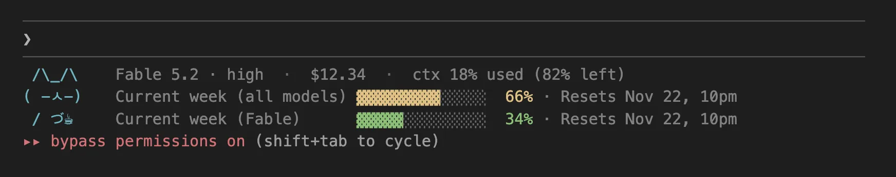
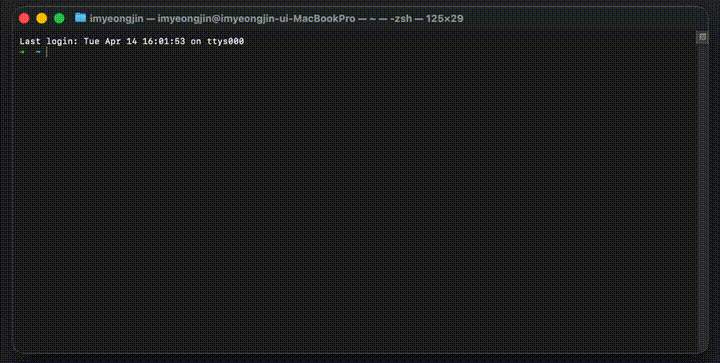

# 🐾 claude-cat

<p align="left"></p>

> **The offline-only Claude Code status line.** A cute cat tells you how much usage is left — without touching a single network endpoint.

[한국어 README →](./README.ko.md)

[](https://www.npmjs.com/package/claude-cat)
[](https://www.npmjs.com/package/claude-cat)
[](LICENSE)
[](https://nodejs.org)
[](https://packagephobia.com/result?p=claude-cat)
[](#why-claude-cat)
[](#why-claude-cat)
[](https://github.com/thingineeer/claude-cat/graphs/commit-activity)

> **🆕 Updated for Claude Code 2.1.327** (2026-11-19) — verified against
> a live statusLine payload. Weekly-only **Ultra** plans (formerly Max),
> `week` + `fable` on one line, the new `spend_limit` window, and
> `Opus 5.5` / `Fable 5.2` model chips. See
> [stdin fields](#stdin-fields-claude-code-21327).

<p align="center">
  
  <br />
  <em>3-row kawaii card — <code>--full --kawaii</code></em>
</p>

<a id="why-claude-cat"></a>
## 🛡️ Why claude-cat

claude-cat only renders the JSON that Claude Code **already pipes to
statusLine scripts via stdin**. Nothing else. That's the whole
design — and the whole safety story:

- **🚫 Zero network calls.** No `api.anthropic.com`. No
  `claude.ai`. No `/api/oauth/usage`. Run it behind a firewall; it
  works the same. `tcpdump` stays empty. (The one exception is
  `claude-cat update`, which asks the npm registry for the latest
  version — and only when you type it.)
- **🚫 Zero credential reads.** Never touches
  `~/.claude/.credentials.json`, the macOS Keychain, or any OAuth
  token. If your npm account is ever compromised, the worst case
  is a funny-looking status line — not a leaked Anthropic account.
- **🚫 Zero outbound writes.** Only writes to
  `~/.claude/claude-cat/` (a local sync cache + optional debug
  dumps). Nothing leaves your machine.
- **✅ Stdin-only**, by policy. Documented in
  [`SECURITY.md`](./SECURITY.md) and enforced by the project's
  threat model — not a side effect.

### Compared to other Claude Code status-line / usage tools

| Feature | **claude-cat** | ccstatusline | claude-dashboard | ccusage |
| --- | :---: | :---: | :---: | :---: |
| Runs on every statusLine render | ✅ | ✅ | ✅ | ❌ (CLI) |
| **No network calls** | **✅** | ❌ (Anthropic API) | ❌ (Anthropic API) | 🟡 (pricing fetch, `--offline` ok) |
| **No OAuth / credential reads** | **✅** | ❌ | ❌ | ✅ |
| Kawaii cat moods 😺 | ✅ | ❌ | ❌ | ❌ |
| Cross-terminal sync | ✅ | ❌ | ❌ | n/a |
| Historical / cost reports | ❌ | 🟡 | ✅ | ✅ |

**Pick claude-cat when** you want a friendly always-on status line
and you care that your toolchain isn't quietly talking to Anthropic
behind your back. **Pair with [`ccusage`](https://github.com/ryoppippi/ccusage)**
if you also want on-demand cost reports — the two are complementary
(claude-cat for live render, ccusage for analysis).

> "Just a cat" isn't a cute tagline — it's the threat model.

## Install

### Quick setup (recommended)

Run the interactive wizard — it walks you through layout, cat theme,
refresh interval, and plan in 30 seconds:

```bash
npx -y claude-cat@latest configure
```

<p align="center">
  
</p>

It writes `~/.claude/settings.json` for you (with a diff preview
first, leaving every other setting untouched). Restart Claude Code
and the line shows up on the next turn.

### Updating

```bash
npx -y claude-cat@latest update            # apply
npx -y claude-cat@latest update --dry-run  # just show what would change
```

One command brings every local copy up to the latest release: it
clears stale `npx` cache entries, upgrades a global install
(`npm i -g`), bumps a pinned `claude-cat@x.y.z` in
`~/.claude/settings.json`, and pre-installs the new version so the
next status-line render is instant. `claude-cat --version` prints the
version you're running. Use `@latest` in the command above — an old
cached copy may not know the `update` subcommand yet.

### Manual setup (paste a prompt)

Pick a mode, paste the prompt into Claude Code, and it edits
`~/.claude/settings.json` for you.

### A) ⭐ Default — compact, one line *(recommended)*

You get a single line: model · effort + usage bars + `$` cost + `ctx %`. No cat.
Wraps on narrow terminals.

```text
opus 5.5 · xhigh | week ▓▓▓▓▓▓▓░░░ 66% (Sun 10pm) | $12.34 | ctx 18%
```

Ultra (formerly Max) is weekly-only, so that's the whole line today.
When Claude Code also sends a Fable weekly bucket, it joins the same
line — no flag needed:

```text
fable 5.2 · high | week ▓▓▓▓▓▓▓░░░ 66% (Sun 10pm) | fable ▓▓▓░░░░░░░ 34% (Sun 10pm) | $12.34 | ctx 18%
```

Plans with a 5-hour session window get a `5h ▓▓▓▓░░░░░░ 47% (1h 19m)`
bar in front of `week`.

```text
Install claude-cat (https://github.com/thingineeer/claude-cat) into my
~/.claude/settings.json as the statusLine.

- type: "command"
- command: "npx -y claude-cat@latest"
- padding: 0
- refreshInterval: 300

Don't touch any other key. Show me the diff first.
```

### B) 3-row kawaii cat

You get a 3-row card: ASCII cat on the left, data rows on the right.
The cat's face and prop change with your usage. The header row carries
model · effort · cost · ctx — effort slots into the header's spare
width, so the card stays 3 rows.

```text
 /\_/\    Fable 5.2 · high  ·  $12.34  ·  ctx 18% used (82% left)
( -ㅅ-)   Current week (all models) ▓▓▓▓▓▓▓▓▓░░░░░  66% · Resets Nov 22, 10pm
 / づ☕    Current week (Fable)      ▓▓▓▓▓░░░░░░░░░  34% · Resets Nov 22, 10pm
```

```text
Install claude-cat (https://github.com/thingineeer/claude-cat) into my
~/.claude/settings.json as the statusLine.

- type: "command"
- command: "npx -y claude-cat@latest --full --kawaii"
- padding: 0
- refreshInterval: 300

Don't touch any other key. Show me the diff first.
```

<details>
<summary>All modes at a glance</summary>

Same install pattern — just swap the `command` value.

<table>
<thead>
<tr><th>flag</th><th>command</th><th>preview</th></tr>
</thead>
<tbody>
<tr>
<td><strong>⭐ (default)</strong></td>
<td><code>npx -y claude-cat@latest</code></td>
<td><pre>opus 5.5 · xhigh | week ▓▓░░░░░░░░ 18% (Fri 1pm) | $0.123</pre></td>
</tr>
<tr>
<td><code>--full --kawaii</code></td>
<td><code>npx -y claude-cat@latest --full --kawaii</code></td>
<td><pre> /\_/\   Opus 5.5 · xhigh · $0.123
( ^ω^ )  week     ▓▓▓░░░░░░░░░░░ 18% · Resets Nov 20, 1pm
 / >🍣</pre></td>
</tr>
<tr>
<td><code>--full</code></td>
<td><code>npx -y claude-cat@latest --full</code></td>
<td><pre>/ᐠ ^ᴥ^ ᐟ\  Opus 5.5 · xhigh · $0.123
week     ▓▓▓░░░░░░░░░░░ 18% · Resets Nov 20, 1pm</pre></td>
</tr>
<tr>
<td><code>--wide</code></td>
<td><code>npx -y claude-cat@latest --wide</code></td>
<td><pre>week ▓░░░░░░░ 18% (Fri 1pm) | $0.123</pre></td>
</tr>
<tr>
<td><code>--full --no-cat</code></td>
<td><code>npx -y claude-cat@latest --full --no-cat</code></td>
<td><pre>Opus 5.5 · xhigh · $0.123
week     ▓▓▓░░░░░░░░░░░ 18% · Resets Nov 20, 1pm</pre></td>
</tr>
</tbody>
</table>

Power-user flags: `--stack=auto|always|never`, `--max-cols=<n>`,
`--hide=<name>[,<name>…]` (drop specific bars — names as shown on the
chip, e.g. `--hide=opus,sonnet` keeps just `week · fable` (plus `5h` on
plans that have it); the
wizard's "Weekly model bars" step sets this),
`--no-model` (drop the compact layout's leading model chip — takes the
effort level with it), `--no-effort` (keep the model, drop the
`· high` effort level — compact and `--full`),
`--no-debug-chip`, `--icons=none|emoji|nerd`. Env vars:
`CLAUDE_CAT_COLUMNS`, `CLAUDE_CAT_DEBUG=1`,
`CLAUDE_CAT_PLAN=pro|ultra|auto` (Pro users: set `pro` to hide weekly
bars — the wizard sets this automatically; the old `max` value still
works and behaves like `ultra`).

</details>

## Reading the output

```text
fable 5.2 · high | week ▓▓▓▓▓▓▓░░░ 66% (Sun 10pm) | fable ▓▓▓░░░░░░░ 34% (Sun 10pm) | $12.34 | ctx 18%
```

| chip | meaning |
| ---- | ------- |
| `opus 5.5` / `fable 5.2` / `sonnet 5.5` | the model this session is talking to — compact layout only (`--full` shows the full name in its header). Hide with `--no-model` |
| `· high` / `· max` | the session's effort level (`effort.level` — `low` / `medium` / `high` / `xhigh` / `max`), riding on the model chip in compact and `--full`. Hide with `--no-effort` |
| `week` / `fable` / `5h` / `spend` | rate-limit window — weekly (all models) / Fable weekly / 5-hour session (plans that have one) / Claude apps gateway spend cap. Any other `rate_limits.seven_day_<model>` bucket shows up as `<model>` automatically |
| `▓▓▓▓░░░░░░` | 10-cell progress bar — green → yellow → red as it climbs |
| `66%` | exact percentage |
| `(Sun 10pm)` / `(1h 19m)` | when that window resets — absolute for weekly, relative for the 5-hour session |
| `$12.34` | **this Claude Code session's running cost in USD** — see below |
| `ctx 18%` | how full the current conversation's token budget is |

### What `$12.34` is — and isn't

It's **this single Claude Code session's running cost**, computed by
Claude Code itself (`cost.total_cost_usd` from stdin JSON).

- ❌ NOT "Extra usage" plan-overage fees — that's a different
  `/usage` popup bar and isn't piped to statusLine scripts.
- ❌ NOT your monthly subscription bill.
- ❌ NOT money leaving your account right now if you're on Pro/Ultra
  (those are flat-rate — the number is informational).
- ✅ On an **API key** it's the real cost. On **Bedrock / Vertex**
  it stays `$0.00` (Claude Code can't compute cost there).

Claude Code prices tokens client-side at list price (or your
[`modelPricing`](https://code.claude.com/docs/en/settings-reference#modelpricing)
table). claude-cat never recomputes it — stdin doesn't carry
per-model cumulative token counts, so a re-calculation would be less
accurate, not more. For reference, current list prices per million
tokens ([models overview](https://platform.claude.com/docs/en/models/overview)):

| model | input / MTok | output / MTok |
| ----- | -----------: | ------------: |
| Claude Fable 5.2 *(latest)* | $8 | $40 |
| Claude Fable 5.1 *(legacy)* | $10 | $50 |
| Claude Opus 5.5 | $4 | $20 |
| Claude Sonnet 5.5 | $2 | $10 |
| Claude Haiku 5.5 | from $0.10 | from $0.50 |

## Cat moods

The cat only shows up in `--full` modes. Six moods — five driven by
usage, one state-driven (resting).

| trigger | `--full` (1-line face) | `--full --kawaii` prop |
| ------- | ---------------------- | ---------------------- |
| no rate limits yet (*resting*) | `/ᐠ -ᴥ- ᐟ\` | 🚬 smoke |
| 0–30 % (*chill*) | `/ᐠ ^ᴥ^ ᐟ\` | 🍣 sushi |
| 30–60 % (*curious*) | `/ᐠ •ᴥ• ᐟ\` | ⌨️ keyboard |
| 60–85 % (*alert*) | `/ᐠ ◉ᴥ◉ ᐟ\` | ☕ coffee |
| 85–95 % (*nervous*) | `/ᐠ ⊙ᴥ⊙ ᐟ\` | 💤 break |
| 95 %+ (*critical*) | `/ᐠ ✖ᴥ✖ ᐟ\` | 🛌 sleeping |

Mood policy: `weekly ≥ 60 %` or `session ≥ 75 %` → alert; any
window ≥ 85 → nervous; any ≥ 95 → critical. Weekly drives the mood
because it's the bar that actually constrains your week — on
weekly-only plans (Ultra) it's the only input.

<details>
<summary>Full 3-row ASCII gallery for every mood</summary>

**resting**
```
 /\_/\
( -.-)
 / >🚬~
```

**chill** (0–30 %)
```
 /\_/\
( ^ω^ )
 / >🍣
```

**curious** (30–60 %)
```
 /\_/\
( •ㅅ•)
 / >⌨️
```

**alert** (60–85 %)
```
 /\_/\
( -ㅅ-)
 / づ☕
```

**nervous** (85–95 %)
```
 /\_/\
( xㅅx)
 / づ💤
```

**critical** (95 %+)
```
 /\_/|
( -.-)zzZ
 /   \
```

</details>

## Plan compatibility

| Plan | Shows | Notes |
| ---- | ----- | ----- |
| Claude **Ultra** *(formerly Max)* | `week` bar (+ `fable` when sent), weekly reset, cat mood, session cost | weekly-only — Claude Code 2.1.327 sends `rate_limits.seven_day` alone |
| Claude Pro | `5h` + `week` bars (set `CLAUDE_CAT_PLAN=pro` to hide weekly) | `rate_limits` appears after first reply |
| Claude apps gateway | `spend` bar (spend-limit %) + cost | `rate_limits.spend_limit`, Claude Code ≥ 2.1.251 |
| Anthropic API key | session cost in USD + cat mood | no rate_limits in stdin JSON |
| Bedrock / Vertex | cost stays at `$0.00` | upstream limitation |

<a id="stdin-fields-claude-code-21327"></a>
## stdin fields (Claude Code 2.1.327)

Verified 2026-11-19 against a live payload dump
(`CLAUDE_CAT_DEBUG=1` → `~/.claude/claude-cat/last-stdin.json`) and the
[statusLine docs](https://code.claude.com/docs/en/statusline).

| field | used for |
| ----- | -------- |
| `rate_limits.seven_day` | `week` bar — present on every subscription plan |
| `rate_limits.five_hour` | `5h` bar — **absent on Ultra**; also dropped once its `resets_at` passes |
| `rate_limits.seven_day_<model>` | per-model weekly bar (`fable`, `opus`, `sonnet`, …) — rendered whenever it arrives |
| `rate_limits.spend_limit` | `spend` bar behind a Claude apps gateway |
| `model.display_name` | model chip (`Opus 5.5` → `opus 5.5`) |
| `effort.level` | `· xhigh` effort chip |
| `cost.total_cost_usd` | `$` chip |
| `context_window.used_percentage` | `ctx` chip |

New in recent releases but not rendered (yet): `prompt_cache`,
`workspace.repo`, `pr`, `session_name`, `prompt_id`.

## What's *not* in stdin JSON (yet)

Some things the `/usage` popup shows but Claude Code doesn't pipe to
statusLine scripts, so claude-cat can't render them today:

- **Fable weekly limit** — on Ultra, `/usage` shows a Fable row
  (Fable may use up to half of the weekly limit), but as of Claude
  Code 2.1.327 the statusLine stdin carries only `seven_day`. claude-cat
  renders `rate_limits.seven_day_fable` (or the older
  `seven_day_overage_included`) as a `fable` bar the moment Claude Code
  sends it — until then the line simply shows `week`.
- **Extra usage** (e.g. `$14 / $20 spent`) — comes from
  `/api/oauth/usage` (private endpoint).

claude-cat stays stdin-only on purpose (see [Why claude-cat](#why-claude-cat)).
Tracked in [issues](https://github.com/thingineeer/claude-cat/issues).

## Security

claude-cat is deliberately small and network-free so it fits
Claude Code's per-message hot path safely.

**What it does** — reads the stdin JSON Claude Code already pipes to
statusLine scripts, prints a colored line.

**What it doesn't do** — no network requests, no credential reads, no
keychain access, no writes outside `~/.claude/claude-cat/`. The
invariants are listed in [SECURITY.md](./SECURITY.md).

### npm supply-chain considerations

`npx -y claude-cat@latest` downloads and runs the latest published
version every time. This is standard for npm but worth knowing:

- **Pin if you want reproducibility** — `npx -y claude-cat@1.6.0`
  instead of `@latest`. Upgrade when an advisory is published.
- **Review the package** — the published tarball only ships `bin/`,
  `src/`, `examples/`, and README/LICENSE (`files` in `package.json`).
  You can audit it before install: `npm pack claude-cat && tar -tf
  claude-cat-*.tgz`.
- **Local install alternative** — clone the repo and point your
  statusLine at `node /path/to/claude-cat/bin/cli.js`. No npm fetch
  at all.

### Reporting a vulnerability

Private advisory only:
**https://github.com/thingineeer/claude-cat/security/advisories/new**

Don't open a public issue. See [SECURITY.md](./SECURITY.md).

## Development

```bash
git clone https://github.com/thingineeer/claude-cat.git
cd claude-cat
git config core.hooksPath .githooks

npm run test:sample    # try a fixture
npm run test:full
```

Contributing guide: [CONTRIBUTING.md](./CONTRIBUTING.md). For
Claude-Code sessions: [CLAUDE.md](./CLAUDE.md).

## License

MIT © thingineeer
