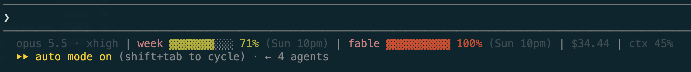

# 🐾 claude-cat

<p align="left"></p>

> **The offline-first Claude Code status line.** A cute cat tells you how much usage is left — by default without touching a single network endpoint.

[한국어 README →](./README.ko.md)

[](https://www.npmjs.com/package/claude-cat)
[](https://www.npmjs.com/package/claude-cat)
[](LICENSE)
[](https://nodejs.org)
[](https://packagephobia.com/result?p=claude-cat)
[](#privacy--security)
[](#privacy--security)

<p align="center">
  
  <br />
  <em><code>--full --kawaii --fable-usage</code></em>
</p>

```text
opus 5.5 · xhigh | week ▓▓▓▓▓▓▓░░░ 66% (Sun 10pm) | $12.34 | ctx 18%
```

Verified against **Claude Code 2.1.327** — weekly-only **Ultra** plans
(formerly Max), `week` + `fable` on one line, `Opus 5.5` / `Fable 5.2`
model chips.

## Quick start

```bash
npx -y claude-cat@latest configure
```

The wizard asks for layout, cat theme, chips, per-model bars, refresh
interval and plan, shows a diff, and writes `statusLine` into
`~/.claude/settings.json` without touching any other key. The next
Claude Code turn shows the line.

<p align="center">
  
</p>

<details>
<summary>Manual setup</summary>

Add this to `~/.claude/settings.json`:

```json
"statusLine": {
  "type": "command",
  "command": "npx -y claude-cat@latest",
  "padding": 0,
  "refreshInterval": 300
}
```

Append flags to `command` for other layouts, e.g.
`npx -y claude-cat@latest --full --kawaii`.

</details>

### Updating

```bash
npx -y claude-cat@latest update            # apply
npx -y claude-cat@latest update --dry-run  # preview only
```

Clears stale `npx` cache entries, upgrades a global install, bumps a
pinned `claude-cat@x.y.z` in `settings.json`, and pre-installs the new
version so the next render is instant. `claude-cat --version` prints
the running version.

## Layouts

<p align="center"></p>

| flag | output |
| ---- | ------ |
| *(default)* | one line — model · bars · `$` · `ctx` |
| `--wide` | one line, no model chip, shorter bars |
| `--full` | 1-line cat face + one row per window |
| `--full --kawaii` | 3-row ASCII cat card with a mood prop |
| `--full --no-cat` | `--full` without the cat |

```text
# default
opus 5.5 · xhigh | week ▓▓▓▓▓▓▓░░░ 66% (Sun 10pm) | $12.34 | ctx 18%

# --wide
week ▓▓▓▓▓░░░ 66% (Sun 10pm) | $12.34 | ctx 18%

# --full --kawaii
 /\_/\    Fable 5.2 · high  ·  $12.34  ·  ctx 18% used (82% left)
( -ㅅ-)   Current week (all models) ▓▓▓▓▓▓▓▓▓░░░░░  66% · Resets Nov 22, 10pm
 / づ☕   Current week (Fable)      ▓▓▓▓▓░░░░░░░░░  34% · Resets Nov 22, 10pm
```

The default line wraps on narrow panes; `--full` stays a 3-row card.
With [`--fable-usage`](#fable-usage-opt-in) the Fable weekly bar joins
the same line, and plans with a 5-hour session window get a `5h` bar
first:

```text
fable 5.2 · high | week ▓▓▓▓▓▓▓░░░ 66% (Sun 10pm) | fable ▓▓▓░░░░░░░ 34% (Sun 10pm) | $12.34 | ctx 18%
sonnet 5.5 · medium | 5h ▓▓▓▓▓░░░░░ 47% (1h 18m) | week ▓▓▓░░░░░░░ 31% (Sun 10pm) | $3.21 | ctx 18%
```

## Reading the line

| chip | meaning |
| ---- | ------- |
| `opus 5.5 · xhigh` | model selected in this session and its effort level (`low` … `max`) |
| `week` | weekly limit, all models |
| `fable` / `opus` / `sonnet` | per-model weekly bucket — any `rate_limits.seven_day_<model>` shows up automatically |
| `5h` | 5-hour session window (plans that have one) |
| `spend` | Claude apps gateway spend limit |
| `▓▓▓▓▓▓▓░░░ 66%` | usage — green → yellow → red |
| `(Sun 10pm)` / `(1h 18m)` | reset time — absolute for weekly, countdown for the 5-hour window |
| `$12.34` | this session's cost, as computed by Claude Code ([details](#what-the--is)) |
| `ctx 18%` | context-window usage |

## Options

| flag | effect |
| ---- | ------ |
| `--full` · `--wide` | layout (default: one line) |
| `--kawaii` · `--no-cat` · `--cat=compact\|kawaii\|none` | cat theme in `--full` |
| `--fable-usage` | **opt-in** Fable weekly bar from the usage API — see [Fable usage](#fable-usage-opt-in) |
| `--hide=<names>` | drop bars by chip name — `--hide=opus,sonnet` keeps `week` + `fable` |
| `--no-model` · `--no-effort` | hide the model chip / only the effort level |
| `--no-cost` · `--no-ctx` | hide the `$` / `ctx` chip |
| `--stack=auto\|always\|never` · `--max-cols=<n>` | wrapping of the one-line layout |
| `--icons=none\|emoji\|nerd` | icons in front of window labels |
| `--no-debug-chip` | hide `[Debug]` while `CLAUDE_CAT_DEBUG` is on |

| env var | effect |
| ------- | ------ |
| `CLAUDE_CAT_PLAN=pro\|ultra\|auto` | `pro` hides weekly bars; `ultra` / `auto` show everything (`max` still works) |
| `CLAUDE_CAT_COLUMNS=<n>` | override the detected terminal width |
| `CLAUDE_CAT_DEBUG=1` | dump the raw stdin to `~/.claude/claude-cat/last-stdin.json` |

## Plans

| plan | shows |
| ---- | ----- |
| **Ultra** *(formerly Max)* | `week` (+ `fable` when sent) — weekly-only, no 5-hour window |
| **Pro** | `5h` + `week` |
| Claude apps gateway | `spend` + `$` |
| API key | `$` (real cost) + resting cat |
| Bedrock / Vertex | `$0.00` — Claude Code can't price these |

`rate_limits` appears after a session's first reply. Idle terminals
reuse the last active session's numbers (dimmed as `stale · 14m ago`
after 10 minutes); the model chip always shows the terminal's own
model.

### stdin fields (Claude Code 2.1.327)

| field | used for |
| ----- | -------- |
| `rate_limits.seven_day` | `week` |
| `rate_limits.five_hour` | `5h` — absent on Ultra |
| `rate_limits.seven_day_<model>` | per-model weekly bar |
| `rate_limits.spend_limit` | `spend` |
| `model.display_name` · `effort.level` | model · effort chip |
| `cost.total_cost_usd` | `$` |
| `context_window.used_percentage` | `ctx` |

Not in stdin: the **Fable weekly limit** on Ultra (the `/usage` popup
has it, but Claude Code 2.1.327 pipes only `seven_day`) and **Extra
usage**. Both live only behind the private `/api/oauth/usage` endpoint.
Fable can be pulled from there with the opt-in flag below; if Claude
Code starts sending it on stdin, that value wins automatically.

<a id="fable-usage-opt-in"></a>
### Fable usage (opt-in)

```bash
npx -y claude-cat@latest --fable-usage
```

Adds the `fable` bar next to `week`. What it does, and the tradeoff:

- Reads your Claude Code **access token** (macOS Keychain item
  `Claude Code-credentials`, else `~/.claude/.credentials.json`) and
  calls `GET https://api.anthropic.com/api/oauth/usage` — the same
  read-only request the `/usage` popup makes. It's an **undocumented
  endpoint**; it can change or go away, and using it is a ToS gray area.
- It **never refreshes** the token. An expired token or a 401 just
  skips until Claude Code renews it.
- The request runs in a **detached background process**, at most every
  5 minutes and once at a time across terminals, with backoff on
  errors. The status line itself only reads a local cache, so it never
  waits on the network.
- Only the Fable percentage and reset time are cached
  (`~/.claude/claude-cat/fable-cache.json`) — never the token.
- After switching accounts the bar hides until the new account's
  numbers arrive (matched by the weekly reset time).

A Fable bar near 100 % counts toward the cat's mood like any weekly
bar; add `--hide=fable` back if you only want it informational.

<a id="what-the--is"></a>
### What the `$` is

`cost.total_cost_usd` — this session's cost, priced by Claude Code at
list price (or your [`modelPricing`](https://code.claude.com/docs/en/settings-reference#modelpricing)).
On Pro/Ultra it's informational, not a bill, and it isn't Extra usage.
claude-cat doesn't recompute it — stdin has no per-model token totals.
List prices per million tokens, for reference
([models overview](https://platform.claude.com/docs/en/models/overview)):

| model | input | output |
| ----- | ----: | -----: |
| Fable 5.2 | $8 | $40 |
| Fable 5.1 *(legacy)* | $10 | $50 |
| Opus 5.5 | $4 | $20 |
| Sonnet 5.5 | $2 | $10 |
| Haiku 5.5 | from $0.10 | from $0.50 |

## Cat moods

| mood | trigger | `--full` | `--kawaii` prop |
| ---- | ------- | -------- | --------------- |
| resting | no rate limits yet | `/ᐠ -ᴥ- ᐟ\` | 🚬 |
| chill | < 30 % | `/ᐠ ^ᴥ^ ᐟ\` | 🍣 |
| curious | ≥ 30 % | `/ᐠ •ᴥ• ᐟ\` | ⌨️ |
| alert | weekly ≥ 60 % or 5h ≥ 75 % | `/ᐠ ◉ᴥ◉ ᐟ\` | ☕ |
| nervous | any ≥ 85 % | `/ᐠ ⊙ᴥ⊙ ᐟ\` | 💤 |
| critical | any ≥ 95 % | `/ᐠ ✖ᴥ✖ ᐟ\` | 🛌 |

Weekly drives the mood — it's the limit that constrains your week, and
on Ultra it's the only one. Windows whose reset time has passed are
ignored.

<details>
<summary>3-row kawaii gallery</summary>

```text
resting     chill       curious     alert       nervous     critical
 /\_/\       /\_/\       /\_/\       /\_/\       /\_/\       /\_/|
( -.-)      ( ^ω^ )     ( •ㅅ•)     ( -ㅅ-)     ( xㅅx)     ( -.-)zzZ
 / >🚬~      / >🍣       / >⌨️       / づ☕      / づ💤       /   \
```

</details>

<a id="privacy--security"></a>
## Privacy & security

claude-cat renders only the JSON Claude Code already pipes to
status-line scripts on stdin.

- **No network by default** — no `api.anthropic.com`, no `claude.ai`,
  no `/api/oauth/usage`. Two explicit exceptions: `claude-cat update`
  (npm registry, only when you run it) and the opt-in
  [`--fable-usage`](#fable-usage-opt-in) flag.
- **No credentials by default** — never reads
  `~/.claude/.credentials.json`, the Keychain, or any OAuth token
  unless you pass `--fable-usage`, which reads the access token only.
- **No writes** outside `~/.claude/claude-cat/` (a cross-terminal cache
  and opt-in debug dumps).

| | **claude-cat** | ccstatusline | claude-dashboard | ccusage |
| --- | :---: | :---: | :---: | :---: |
| Live status line | ✅ | ✅ | ✅ | ❌ (CLI) |
| No network calls (default) | ✅ | ❌ | ❌ | 🟡 |
| No credential reads (default) | ✅ | ❌ | ❌ | ✅ |
| Cat moods 😺 | ✅ | ❌ | ❌ | ❌ |
| Cost reports | ❌ | 🟡 | ✅ | ✅ |

Pair it with [`ccusage`](https://github.com/ryoppippi/ccusage) for
historical cost reports.

**Supply chain** — `npx -y claude-cat@latest` runs the newest release
each time. Pin a version (`claude-cat@1.7.0`) for reproducibility,
audit the tarball (`npm pack claude-cat && tar -tf claude-cat-*.tgz` —
only `bin/`, `src/`, `examples/`, README, LICENSE), or point
`statusLine` at a local clone: `node /path/to/claude-cat/bin/cli.js`.

**Vulnerabilities** — report privately via
[security advisories](https://github.com/thingineeer/claude-cat/security/advisories/new),
not public issues. See [SECURITY.md](./SECURITY.md).

## Development

```bash
git clone https://github.com/thingineeer/claude-cat.git
cd claude-cat
git config core.hooksPath .githooks
npm install
npm run test:ultra          # one fixture
./scripts/capture-all.sh    # every fixture × layout × theme
```

Node.js 22+. See [CONTRIBUTING.md](./CONTRIBUTING.md).

## License

MIT © thingineeer
